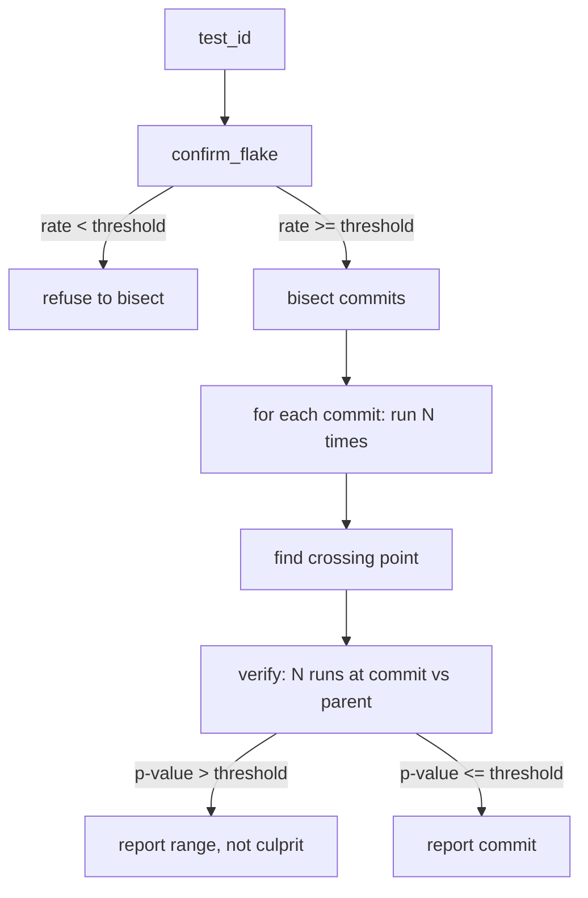

# onset

[](https://github.com/kallurayaankit/onset/actions/workflows/test.yml)
[](https://opensource.org/licenses/MIT)
[](https://www.python.org/downloads/)

**Find the commit that made a test flaky.**

```bash
pip install -e .
onset find tests/test_auth.py::test_session_expiry --ref v2.3.0
```

## The problem

`pulse` tells you a test is flaky. `culprit` tells you why it failed. Neither tells you **when it started being flaky**.

You have a test that flips 56% of runs. It's been in the suite for months. The test file hasn't changed. The bug is in the production code it depends on, and the flake rate went from 0% to 50% on some specific commit six weeks ago. You don't know which one.

`git bisect` is the tool for finding a breaking commit, but it's binary: pass or fail. A flaky test is neither. You'd need to run the test 10 times at each commit, count failures, and eyeball the numbers. That's a full afternoon per flaky test. Nobody does it.

## The fix

`onset` automates the loop.

1. **Confirm** the test is actually flaky at HEAD (rate above threshold)
2. **Bisect** the commits between a known-good ref and HEAD, running the test N times at each one
3. **Verify** statistically: same N at the candidate commit and its parent, two-proportion z-test
4. **Report** the commit only if the difference is provable

If the p-value is above threshold, `onset` says *no single culprit* and reports the range instead. A wrong culprit is worse than no culprit.

## Output

```
$ onset find tests/test_auth.py::test_session_expiry --ref v2.3.0

Commits between v2.3.0 and HEAD: 47
Runs per commit: 10
Min flake rate: 0.05

Confirming flake at HEAD...
  HEAD: 6/10 failures (rate 0.6)

Bisecting...
  a1b2c3d  2/10  rate=0.2
  f9e8d7c  6/10  rate=0.6
  ...

Verification:
  parent (a1b2c3d^): 1/10 (rate 0.1)
  culprit (a1b2c3d): 6/10 (rate 0.6)
  p-value: 0.0031

============================================================
ONSET FOUND
============================================================
  Commit:    a1b2c3d...
  Author:    alice@example.com
  Date:      2026-08-15
  Message:   refactor: move session lookup to cache layer

  Flake rate before:  1/10  (10%)
  Flake rate after:   6/10  (60%)
  p-value:            0.0031

  Changed files:
    src/auth/session.py
    src/auth/cache.py

  Reproduce:
    git checkout a1b2c3d
    pytest tests/test_auth.py::test_session_expiry --count 10
```

## Architecture



## Quickstart

```bash
python -m venv .venv
.venv\\Scripts\\activate
pip install -e .

onset find <test-id> --ref <known-good-tag>
onset find <test-id> --ref v2.3.0 --runs 20 --html report.html --open
onset find <test-id> --ref v2.3.0 --json out.json
```

## Configuration

`.env`:

```
ONSET_MIN_FLAKE_RATE=0.05
ONSET_MIN_RUNS=10
ONSET_MAX_RUNS=50
ONSET_P_THRESHOLD=0.05
ONSET_TIMEOUT=60
```

## What this is not

- **Not a flake detector.** Use `pulse` for that. `onset` assumes you already know the test is flaky.
- **Not a root-cause analyzer.** Use `culprit` for that. `onset` tells you *when*, not *why*.
- **Not fast.** Bisecting 47 commits at 10 runs each is 470 pytest invocations. It's a background job, not a pre-commit hook.

## Status

Early. Works on Python projects with git history. Roadmap: parallel bisection (run multiple commits at once), incremental caching (skip commits already tested), multi-test bisection (find the commit that broke N tests at once).

## License

MIT
